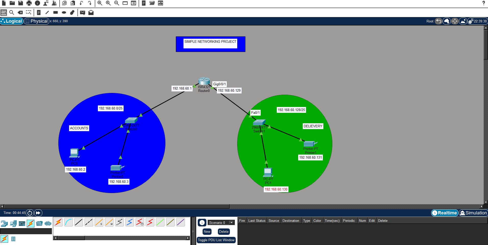
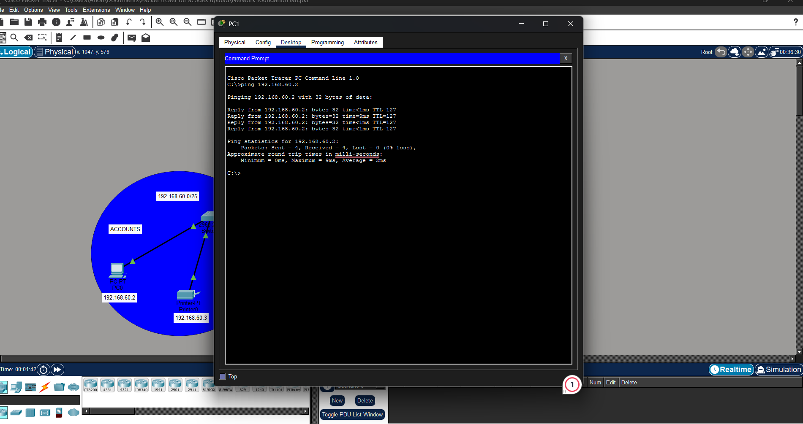

# Project 01 — Network Foundations Lab

**Status:** Complete  
**Packet Tracer file:** [`project-01-network-foundations.pkt`](../packet-tracer/project-01-network-foundations.pkt)  
**Topology image:** 

## Case study brief

Design a Packet Tracer network connecting the Accounts and Delivery departments:

- Each department must have at least one PC and appropriate host devices such as a printer.
- Select an appropriate number of switches and routers.
- Configure interfaces and end devices with suitable IP addresses, subnet masks, and gateways using subnetting.
- Connect devices with suitable cables.
- Test communication between Accounts and Delivery.

**Base network:** `192.168.60.0`. The brief does not provide a prefix. This lab uses the default classful `/24` parent network and divides it into two `/25` subnets.

## Goal

Connect the Accounts and Delivery departments so that their PCs can communicate through a router. Each department also has a printer on its local network.

## Topology observed

- One ISR 4321 router
- Two 2960 switches, one per department
- One PC and one printer in each department, meeting the clarified minimum of one PC per department
- Each switch connects to its department's router interface

The case study requirement has been clarified to at least one PC per department.

## Addressing plan observed

The labels in the screenshot show two `/25` LANs. They are valid sibling subnets of `192.168.60.0/24`.

| Device | Address shown | Subnet mask | Expected gateway |
|---|---|---|---|
| Accounts router interface | 192.168.60.1 | 255.255.255.128 | — |
| Accounts PC | 192.168.60.2 | 255.255.255.128 | 192.168.60.1 |
| Accounts printer | 192.168.60.3 | 255.255.255.128 | 192.168.60.1 |
| Delivery router interface | 192.168.60.129 | 255.255.255.128 | — |
| Delivery PC | 192.168.60.130 | 255.255.255.128 | 192.168.60.129 |
| Delivery printer | 192.168.60.131 | 255.255.255.128 | 192.168.60.129 |

**Subnet note:** `192.168.60.0` alone does not specify a prefix. The screenshot's two `/25` LANs fit inside a `/24` parent: `192.168.60.0/25` and `192.168.60.128/25`. If the assignment instead specifies `192.168.60.0/25` as the parent network, split it into two `/26` networks and renumber the Delivery LAN.

## Implementation and verification

The topology screenshot shows active link indicators on the router, switches, PCs, and printers. The ping evidence shows four successful replies with zero packet loss when the Delivery PC pings the Accounts PC at `192.168.60.2`.

```text
Delivery PC: ping 192.168.60.2
Packets: Sent = 4, Received = 4, Lost = 0 (0% loss)
```



## What I learned

Subnetting the `/24` parent into two `/25` networks provides a separate LAN for each department. A router connects those LANs, and the successful ping confirms end-to-end IPv4 communication between them.

