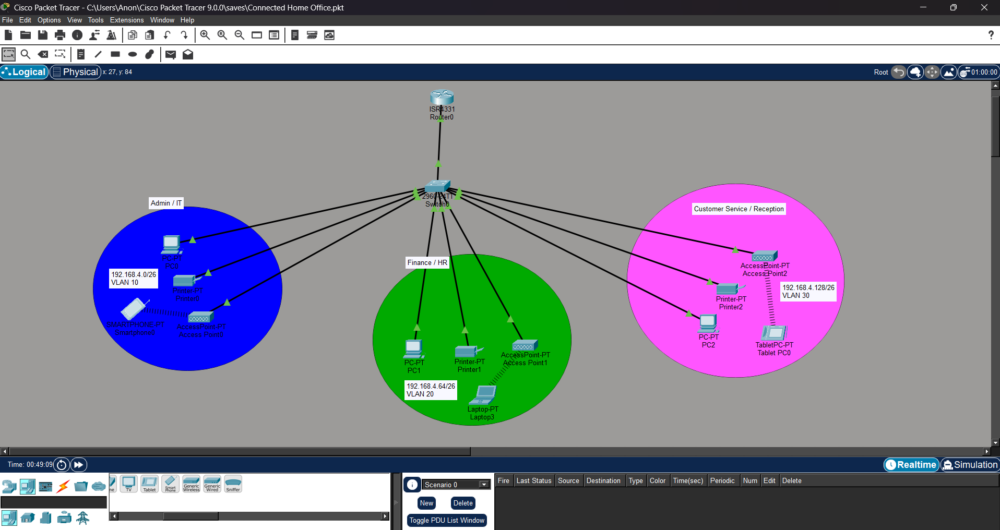

# Project 02 — Connected Home Office

**Status:** Built; evidence documented below  
**Packet Tracer file:** [`project-02-connected-home-office.pkt`](../packet-tracer/project-02-connected-home-office.pkt)  
**Topology:** 

## Case study

case study correction
Case Study: SOHO Network Implementation for "GreenFarm Foods Nigeria Ltd"
Background:
GreenFarm Foods Nigeria Ltd is a fast-growing agribusiness based in Ikeja, Lagos, with over 2 million customers nationwide. The company handles the nationwide processing, buying, and selling of agricultural food items, with all central operations currently managed from its main corporate headquarters.
To reduce heavy customer traffic at the Lagos headquarters and expand its supply chain operations into the eastern region, the company intends to set up a brand-new regional branch office in Ogun State.
As a requirement from management, this new branch network must operate completely separate from the corporate HQ network. You have just been hired as a junior IT network support engineer to design and implement the network architecture for the new Ogun branch.
Network Requirements & Specifications
1. Hardware Constraints:
   - The branch is a small office setup and must use only one router and one switch (all must be Cisco hardware).
2. Departments:
   - The branch office must be divided into three distinct departments:
     - Admin / IT
     - Finance / HR
     - Customer Service / Reception
3. VLAN Segregation:
   - Each department must operate in a different VLAN for security and traffic isolation.
4. Wireless Access (Wi-Fi):
   - Each department must have a wireless access point deployed so staff and visitors can connect via Wi-Fi.
5. Dynamic IP Assignment (DHCP):
   - All host devices (PCs, printers, mobile devices, tablets) across all departments must obtain their IPv4 addresses automatically using the branch router configured as a DHCP server.
6. Inter-VLAN Routing:
   - Although separated into different VLANs, devices in all departments must be able to communicate smoothly with each other (requiring router sub-interfaces / Inter-VLAN routing configuration).
7. Base Network IP:
   - The ISP has allocated a base network address of 192.168.4.0 for this branch. You are required to perform proper subnetting to accommodate the 3 separate departmental subnets.

## Design assumptions

The case study provides `192.168.4.0` without a prefix. This implementation assumes the allocated parent network is `192.168.4.0/24`, then divides it into four `/26` networks. Three are assigned to departments; one remains spare. If the ISP allocation uses a different prefix, the addressing plan must be recalculated.

## VLAN and IPv4 plan

| Department | VLAN | Subnet | Router gateway | Usable host range | Broadcast |
|---|---:|---|---|---|---|
| Admin / IT | 10 | `192.168.4.0/26` | `192.168.4.1` | `192.168.4.1–192.168.4.62` | `192.168.4.63` |
| Finance / HR | 20 | `192.168.4.64/26` | `192.168.4.65` | `192.168.4.65–192.168.4.126` | `192.168.4.127` |
| Customer Service / Reception | 30 | `192.168.4.128/26` | `192.168.4.129` | `192.168.4.129–192.168.4.190` | `192.168.4.191` |
| Spare | — | `192.168.4.192/26` | — | `192.168.4.193–192.168.4.254` | `192.168.4.255` |

Subnet mask for each department: `255.255.255.192` (`/26`). Each subnet has 62 usable IPv4 addresses.

## Topology and implementation

The topology contains one Cisco ISR 4331 router, one Cisco 2960 switch, and three access points—one per department. Each department includes a PC, printer, and wireless client (smartphone, laptop, or tablet). The router uses 802.1Q subinterfaces on `GigabitEthernet0/0/0` for VLANs 10, 20, and 30. DHCP pools are configured for all three departmental subnets; the Customer Service / Reception pool is labeled `CS/R` in the router configuration.

The topology labels show the three `/26` departmental networks. The switch configuration screenshot shows access ports assigned to VLANs 10, 20, and 30, plus a trunk-mode port.

## Evidence

- [Topology](../images/project-02-topology.png)
- [Admin / IT PC DHCP lease](../images/project-02-admin-dhcp.png): `192.168.4.2/26`, gateway `192.168.4.1`; DHCP request successful.
- [Finance / HR PC DHCP lease](../images/project-02-finance-dhcp.png): `192.168.4.66/26`, gateway `192.168.4.65`; DHCP request successful.
- [Router subinterfaces](../images/project-02-router-subinterfaces.png): 802.1Q subinterfaces and gateway addresses for VLANs 10, 20, and 30.
- [Router DHCP pools](../images/project-02-dhcp-pools.png): pools for all three department subnets; `CS/R` is Customer Service / Reception.
- [Switch VLANs and trunk port](../images/project-02-switch-vlans-trunk.png): access ports for VLANs 10, 20, and 30 and a port configured as a trunk.
- [Inter-VLAN ping](../images/project-02-inter-vlan-ping.png): PC0 pings `192.168.4.131`; the first request times out and the next three receive replies (3 of 4 received, 25% loss).

## Verification record

The supplied screenshots confirm successful DHCP assignment for the Admin / IT and Finance / HR PCs. The router configuration shows pools for all three VLANs, including `CS/R`, and the switch configuration shows the VLAN access ports and a trunk-mode port. The ping screenshot shows reachability from PC0 to `192.168.4.131`(PC2) after an initial timeout; it does not show a clean 0% loss result.

## Reflection

This lab practices VLAN-based department separation, subnetting, router-on-a-stick, and centralized DHCP. The three VLANs remain distinct at Layer 2 while the router provides the Layer 3 path for inter-department communication. The Ogun branch is designed to operate without a link to the Lagos HQ.

